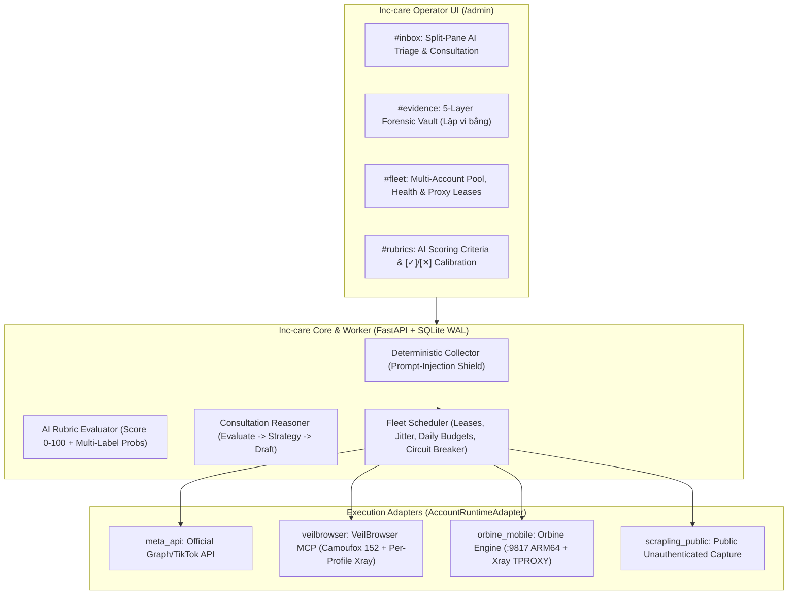

# LNC Care — Multi-Account Fleet, Antidetect Reuse & AI Consultation Architecture Plan

- **Date:** 2026-11-10
- **Workflow:** `/w1-researchandplan`
- **Project Root:** `D:\Python\projects\lnc-care`
- **Related Repos & Research:**
  - `D:\Python\projects\VeilBrowser` (Tauri 2 + Rust + Camoufox 152 + Chromium Cloak 146, wired via `veilbrowser__*` MCP)
  - `D:\Python\projects\Orbine` (Android-first multi-device ADB/scrcpy control station + engine `:9817`)
  - `D:\Python\projects\Antidetect` (`00_INVENTORY.md`, `.docs/PLANNER-DIGEST.md`, `research/RN1..RN5`)

---

## 1. Executive Summary & Architectural Verdict

When `lnc-care` scales from a handful of official Facebook Pages to **dozens or hundreds of accounts** (personal profiles, regional shop care accounts, consultation/seeding personas, friend-triage accounts, and forensic evidence scouts), a single headless scraper (`lnc-scrapling`) with exported cookie files will fail due to **fingerprint collision, TLS/JA4 mismatch, WebRTC/QUIC IP leaks, and missing IndexedDB/Passkey device bindings**.

By cross-referencing the completed reverse-engineering audits in `D:\Python\projects\Antidetect\research\RN1..RN5` against our own codebase (`VeilBrowser` and `Orbine`), **we do NOT need to build a new antidetect browser, emulator, or VM hypervisor from scratch**:

| Tier | Execution Engine | What to Reuse Immediately | What to Borrow from `D:\Python\projects\Antidetect` | Target Use in `lnc-care` |
|---|---|---|---|---|
| **Tier 1: Official API (`meta_api`)** | Native Graph API / TikTok Business API in `lnc-care` | `lnc-ads` OAuth, encrypted `Vault`, per-page token isolation | — | Owned FB Pages & IG Business accounts (webhooks, insights, high-volume public/private replies) |
| **Tier 2: Antidetect Browser Fleet (`veilbrowser`)** | **`VeilBrowser`** (`D:\VeilBrowser\veilbrowser.exe` + Business MCP `veilbrowser__*`) | **Camoufox 152** (4 major versions newer than Antidetect Cloud's `Vifox 148`) + Chromium Cloak 146 + Profile/Group/Proxy CRUD | 1. **`RN2` (`launch.exe`):** `xray.exe` + `wintun.dll` per-process proxy routing + UDP/WebRTC leak block. 2. **`RN5` (Incogniton):** HKDF 64-bit sub-seeding per surface + **Portable Passkey Store (FIDO2)** + 4-way differential profile sync. | **Primary lane for 10–500+ web accounts:** Personal FB/IG feeds, Friend Triage, Customer Consultation accounts, and authenticated **Evidence Vault ("Lập vi bằng")** captures. |
| **Tier 3: Mobile Device Fleet (`orbine_mobile`)** | **`Orbine`** (`D:\Python\projects\Orbine`, Engine API `127.0.0.1:9817`) on **Physical ARM64 Android** | ADB/scrcpy session manager, Proxy Profiles (`m4`), Automation Runner (`m5`), Apps Library (`m10`), Pixel actions (`m11`) | 1. **`RN1` (`Antidetect Android`):** `devices.json` (`11.6 MB`, 2,638 OEM hardware profiles) + `mcc.json`. 2. **`RN1` Network:** `xray` TPROXY (`dokodemo-door` + `iptables` + `XRAY_FAILSAFE_WD` fail-closed watchdog to block QUIC/Cronet leaks). 3. **`RN1` (`xViewer`):** `63 split-APK corpus` + USB AOA2 HID (`hidmanager.apk`). | **High-trust mobile-only accounts:** TikTok personal/shop accounts, Instagram DM/Story care, and accounts where `MetaSec`/`libmetasec_ml` penalizes desktop browsers. |
| **Tier 4: Isolated OS VM Fleet (`veilmachine_vm`)** | **`VeilMachine`** blueprint (`RN3` VMware/VBox orchestrator) | Optional future lane; do not block `lnc-care` V1/V2 on full OS VMs | **`RN3` (`Antidetect Machine`):** 21 JSON hardware catalogs (`mainboard.json`, `CPU.json`, `GPU.json`), `.vmx` 80-key hypervisor spoofing + Linked Clones (<1s) + **Virtual Router VM** (`router.vmx` MAC-based transparent proxy, zero guest footprint). | **Ultra-high-value isolated desktops:** Agency Business Manager admins or dedicated client workstations. |

### Key Strategic Decisions (What NOT to Do)
1. **Do NOT embed `Vifox` binaries (`RN2`):** `Vifox` is just an older, sloppily packaged Camoufox 148 cross-build. `VeilBrowser` already runs Camoufox 152 with WebRTC ICE leak patches.
2. **Do NOT use `Vifox Android APK` (`RN1` Phase 2):** It has zero C++ Gecko patches and relies on a 3,722-line `content.js` WebExtension that disables itself on Cloudflare/DataDome.
3. **Do NOT rely on x86_64 Android Emulators + `LD_PRELOAD` (`libhook_engine.so`) for Tier-1 social apps (`RN1` Phase 1):** TikTok (`libmetasec_ml.so`), Meta, and Shopee use raw `svc #0` syscalls, `/proc/self/maps` inspection, Widevine DRM, and custom QUIC (`Cronet`/`xquic`) stacks. When mobile execution is required, use `Orbine` with physical ARM64 phones + `xray` TPROXY fail-closed routing.
4. **Keep `lnc-care` as the Control Plane & Brain:** `lnc-care` does not bundle browser binaries or hypervisors inside its own container. Instead, `lnc-care-worker` leases profiles/devices from `VeilBrowser` (`veilbrowser__*` MCP) and `Orbine` (`:9817` REST/WS) through a clean **`AccountRuntimeAdapter`** interface.

---

## 2. System Architecture: `lnc-care` Multi-Account Control Plane

---

## 3. Data Model Additions for Multi-Account Fleet & AI Consultation

In addition to the core tables in `.docs/plan.md` §4 (`channels`, `posts`, `comments`, `comment_evaluations`, `evaluation_feedback`, `evidence_cases`, `evidence_items`), scaling to a large account pool adds three tables:

| Table | Columns & Contract |
|---|---|
| `account_runtimes` | `id`, `org_id`, `shop_id` (nullable), `label`, `platform` (`facebook`/`instagram`/`tiktok`/`youtube`), `account_role` (`owned_page`, `personal_main`, `care_consultant`, `friend_hygiene`, `evidence_scout`), `adapter` (`meta_api`, `veilbrowser`, `orbine_mobile`, `scrapling_public`), `runtime_profile_id` (`veilbrowser_profile_id` or `orbine_device_id`), `proxy_uri_ref` (vault envelope ref, never plaintext credentials), `expected_exit_ip`, `expected_country`, `health_status` (`healthy`, `warming`, `leased`, `cooldown`, `checkpointed`, `disabled`), `consecutive_anomalies`, `daily_read_budget`, `daily_write_budget`, `reads_today`, `writes_today`, `last_lease_at`, `last_checkpoint_reason`, `updated_at` |
| `runtime_leases` | `id`, `runtime_id`, `job_id`, `worker_id`, `leased_at`, `expires_at`, `released_at`, `exit_ip_verified` (bool), `status` (`active`, `completed`, `aborted_anomaly`) |
| `consultation_playbooks` | `id`, `org_id`, `shop_id`, `channel_id` (nullable), `name`, `rubric_labels_json` (custom label weights & descriptions), `auto_suggest_threshold` (default `80`), `auto_consult_enabled` (bool, default `false`), `consultation_knowledge_md` (pricing rules, shipping policy, FAQ, tone of voice), `forbidden_topics_json`, `updated_at` |

---

## 4. Detailed Feature Workflows

### 4.1 Workflow A: Multi-Account Ingestion & Anti-Ban Fleet Scheduling
1. **Concurrency Pool & Lease Guard:**
   - `lnc-care-worker` enforces `MAX_CONCURRENT_BROWSER_SESSIONS` (e.g., `4` to `8` per host depending on RAM; each Camoufox 152 instance uses ~350–600 MB RAM).
   - Before starting a session via `veilbrowser__sessions_prepare_start` + `veilbrowser__sessions_start`, the worker acquires a row in `runtime_leases` and verifies that no other job holds that `veilbrowser_profile_id`.
2. **Pre-Flight Proxy & Identity Verification (Fail-Closed):**
   - When the profile launches, the worker first checks the session's outbound IP/ASN against `account_runtimes.expected_exit_ip` / `expected_country`. If the proxy is down or leaking, the worker aborts immediately (`aborted_anomaly`) before touching any social domain.
3. **Human Jitter & Action Budgets:**
   - Polls are scheduled with randomized jitter (`poll_interval_min ± 35%`), active-hour windows matching the account's timezone, and passive feed scroll keepalives.
   - Each account enforces `daily_read_budget` and `daily_write_budget`.
4. **Anomaly & Checkpoint Circuit Breaker:**
   - If the DOM/URL detector sees `/checkpoint/`, `/login/`, `security_check`, or an unexpected challenge, `lnc-care` **never attempts to solve CAPTCHAs or retry**. It immediately sets `health_status = 'checkpointed'`, pauses the account, captures a diagnostic screenshot, and sends an alert via `lnc-cygnus-telegram-notify` so an operator can inspect the profile directly in the `VeilBrowser` desktop UI.

### 4.2 Workflow B: `Code Collects → AI Evaluates → AI Reasons Reply → Guarded Consult`
1. **Step 1 — Deterministic Code Collector (Prompt-Injection Shield):**
   - Pure Python code extracts comment text, parent thread, post caption, product SKU/price metadata, and commenter history. Untrusted text is passed strictly as data fields into an isolated structured-output LLM call with **zero tool access**.
2. **Step 2 — Multi-Label Rubric Scoring (`comment_evaluations`):**
   - Computes `overall_score` (`0–100`), `recommended_action`, `confidence`, `data_quality`, 3–4 `reasoning_bullets`, and per-label probabilities (`0–100%`) across Commercial (`purchase_intent`, `price_inquiry`, `product_spec`, `shipping_policy`, `praise_feedback`, `complaint_urgent`) and Community/Safety (`positive`, `constructive`, `polite`, `spam_seeding`, `negative`, `defamation_abuse`).
3. **Step 3 — Consultation Reasoning (`reply_strategy` + `reply_drafts`):**
   - Using the structured evaluation + `consultation_playbooks.consultation_knowledge_md`, the AI formulates a step-by-step **Reply Strategy** (*suy luận trả lời khách thế nào, báo giá/tư vấn mẫu gì, có cần nhắn riêng không*) and generates both a **Public Reply Draft** and an optional **Private Reply / DM Draft**.
4. **Step 4 — Human Calibration (`[✓]`/`[✕]`) & Guarded Execution:**
   - In `/admin/#inbox` (split-pane UI inspired by `.docs/assets/ui-inspiration-triage-rubric.jpg`), operators review the probability bars, click `[✓]`/`[✕]` (`evaluation_feedback`) to calibrate the rubric, and press `1` (`Approve & Send`), `2` (`Hold / Edit`), or `3` (`Hide / Ignore`).
   - For accounts/channels where the owner enables `auto_consult_enabled = true`, comments that exceed `auto_suggest_threshold` (e.g. `≥ 85/100`) with high confidence and `0%` risk flags (`complaint_urgent`, `defamation_abuse`) can trigger guarded consultation replies automatically with full audit logging and idempotency keys.

### 4.3 Workflow C: Evidence Vault — 5-Layer Forensic Capture ("Lập vi bằng số")
1. **Trigger:** Operator clicks `[Capture Evidence / Lập vi bằng]` on a comment flagged `defamation_abuse` or pastes a target URL into `/admin/#evidence` (or calls MCP `care__evidence_capture`).
2. **Account Selection:**
   - If the target URL is public, uses `scrapling_public` or a designated `evidence_scout` profile in `VeilBrowser` (protecting the owner's main personal account from being detected viewing the target).
   - If the target post is Friends-only or in a private group, uses an authorized `veilbrowser` profile that has visibility.
3. **5-Layer Deterministic Collection:**
   - **Layer 1 (Immutable IDs):** Extracts numerical `actor_uid`, `post_id`, `comment_id`, and canonical permalinks from page data/GraphQL payloads.
   - **Layer 2 (Full Expansion):** Switches comment filter to *"All comments"* and expands all collapsed replies and *"See more"* blocks.
   - **Layer 3 (Visual & Network Replay):** Captures full-page screenshot, viewport scroll screenshots, PDF print, single-file MHTML/DOM snapshot, and **Playwright Trace + HAR** (containing live `F5` reload, raw GraphQL JSON responses, server IP, TLS certificate details, and UTC server `Date` headers).
   - **Layer 4 (Original Media):** Downloads all attached images/videos at full resolution.
   - **Layer 5 (Cryptographic Seal & Watchdog):** Hashes every file with **SHA-256**, generates `manifest.json` + Markdown/PDF forensic summary report, packages a `.zip` bundle under `DATA_DIR/evidence/<case_id>/`, and schedules `evidence_watchdog` jobs (+6h, +24h, +72h) to record if the author later edits or deletes the post.

---

## 5. Phased Implementation Roadmap

### Phase 0: Evidence & Fleet Readiness (Completed / Final Checks)
- Meta token probe, channel inventory (14 Pages + 3 IG), Postiz app ID separation (`39303237442608473` vs `1821062268930458`), and Antidetect reuse mapping (`RN1–RN5` → `VeilBrowser` + `Orbine`).

### Phase 1: Core App, Split-Pane AI Triage Inbox & Consultation Studio (Local, Offline)
1. Scaffold `lnc-care` + `lnc-care-worker` (`FastAPI` + `SQLite WAL` + vanilla `/admin` UI, `VERSION 0.1.0.0`).
2. Implement database schema: org/shop/vault, `channels`, `posts`, `comments`, `comment_evaluations`, `evaluation_feedback`, `consultation_playbooks`, `reply_drafts`, `comment_actions`.
3. Build the **Deterministic Collector + AI Rubric Evaluator + Consultation Reasoner** (`Evaluate → Reason → Consult`) with strict prompt-injection isolation.
4. Build the **Split-Pane Triage Inbox UI (`/admin/#inbox`)** following `.docs/assets/ui-inspiration-triage-rubric.jpg` (bucket pills, grouped score list, threshold bar, reasoning bullets, multi-label probability bars with `[✓]/[✕]` buttons, Reply Strategy studio, keyboard shortcuts `1/2/3`).
5. Expose `/mcp` with Hub v3/v4 HMAC delegation and read/evaluation/draft tools.

### Phase 2: Realtime Webhooks, Post Archive & 5-Layer Evidence Vault
1. Implement `/webhooks/meta` (`X-Hub-Signature-256` verification, challenge, fast enqueue).
2. Implement `lnc-care-worker` for post media archiving and public permalink screenshots.
3. Implement **Evidence Vault (`#evidence`, `evidence_cases`, `evidence_items`, `care__evidence_capture`, `care__evidence_case_get`)** with 5-layer forensic bundling (UID extraction, thread expansion, screenshot/MHTML/HAR/trace, media download, SHA-256 manifest `.zip`, +6h/+24h/+72h watchdog).

### Phase 2b: Multi-Account Fleet Orchestration (`VeilBrowser` & `Orbine` Adapters)
1. Implement `account_runtimes` and `runtime_leases` tables + `/admin/#fleet` UI (account health, proxy status, daily budgets, lease monitor).
2. Implement `VeilBrowserAdapter` calling `veilbrowser__*` MCP (`sessions_prepare_start`, `sessions_start`, pre-flight exit-IP check, feed/comment/friend-triage read, `sessions_stop`) with concurrency leases and jittered scheduling.
3. Port the two high-value `Antidetect` upgrades into `VeilBrowser` (tracked under `VeilBrowser` lane `B01/B02`): per-process `xray + wintun` proxy wrapper (`RN2`) and Portable Passkey Store + HKDF sub-seeding (`RN5`).
4. Implement optional `OrbineMobileAdapter` stub/client (`127.0.0.1:9817`) for mobile-only accounts using `RN1` `devices.json` catalog and `xray` TPROXY fail-closed rules.
5. Enforce anomaly/checkpoint circuit breaker + `lnc-cygnus-telegram-notify` alert.

### Phase 3: Guarded Writes & Progressive Auto-Consultation
1. Implement guarded `comment_reply`, `comment_hide_set`, `comment_private_reply` with idempotency keys, readback verification, audit trail, and `PROVIDER_WRITES_ENABLED` gate.
2. Implement progressive auto-consultation rules (only when `auto_consult_enabled=true`, `score >= threshold`, high confidence, zero risk flags, and supported channel adapter).
3. Add TikTok Business Account and YouTube Data API adapters once scopes are approved.

### Phase 4: Production Release & Hub Onboarding
1. Push to Gitea `apps/lnc-care` + GitHub mirror; deploy Portainer stack on `10.21.4.101:8482`.
2. Configure NPM FR `care-mcp.lengoc.me` (split access: `/webhooks/*` public, `/admin` + `/api` + `/mcp` internal).
3. Pair with Business MCP Hub (`care__*`) and update `lnm-care` skill documentation.

### Phase 5: Testing & Verification Phase (Mandatory Quality Gate)
1. **Unit & Schema Tests:** Vault encryption, SQLite WAL concurrency, AI rubric output validation, prompt-injection isolation tests (adversarial comment payloads must never alter system instructions or trigger writes).
2. **Fleet & Lease Tests:** Concurrency limit enforcement, pre-flight proxy mismatch fail-closed abort, checkpoint detection auto-pause + alert simulation, write-guard rejection on read-only personal profiles (`channel_adapter_unsupported`).
3. **Forensic Bundle Verification:** Automated test verifying that `evidence_capture` produces all 5 layers, valid `manifest.json` SHA-256 digests, and reproducible `.zip` output.
4. **MCP & UI Smoke Tests:** HMAC delegation signature/replay/scope tests + Playwright UI smoke across `#inbox`, `#evidence`, and `#fleet`.

---

## 6. Security, Secrets, Breaking Changes & Rollback Strategy

### 6.1 Concrete Deliverables per Phase
- **Phase 1 Deliverables (Core + Đánh giá Comment + Suy luận trả lời tư vấn khách):**
  - `app/main.py`, `app/store.py`, `app/vault.py`, `app/evaluator.py`, `app/mcp_server.py`.
  - Giao diện `/admin/#inbox` Split-Pane Triage (`app/public/index.html`, `app/public/app.js`, `app/public/styles.css`) lấy cảm hứng từ `Friend Triage`: đánh giá comment đa nhãn, thanh xác suất `[✓]/[✕]`, suy luận trả lời (`Evaluate → Reason → Consult`) để tự động hóa trao đổi và tư vấn khách.
- **Phase 2 Deliverables (Evidence Vault / Chụp thông tin bài viết làm bằng chứng lập vi bằng):**
  - `app/webhooks.py`, `app/worker.py`, `app/evidence.py`, giao diện `/admin/#evidence`.
  - Thu thập trọn gói 5 lớp bằng chứng (`evidence_cases`, `evidence_items`, `manifest.json`, `.zip` SHA-256) khi cần chụp thông tin bài viết làm bằng chứng / lập vi bằng + watchdog hậu kiểm (+6h/+24h/+72h).
- **Phase 2b Deliverables (Số lượng lớn tài khoản — Tận dụng `Antidetect`, `VeilBrowser`, `Orbine`):**
  - `app/fleet.py` (`AccountRuntimeAdapter`, `account_runtimes`, `runtime_leases`) + giao diện `/admin/#fleet`.
  - Tích hợp trình duyệt ẩn danh `VeilBrowser` (Camoufox 152 + mượn `xray + wintun` từ `RN2` và `Portable Passkey Store` từ `RN5`), điện thoại giả lập / vật lý `Orbine` (mượn `devices.json` 2,638 OEM + `xray` TPROXY fail-closed từ `RN1`), và dự phòng máy ảo PC `VeilMachine` (`RN3`).

### 6.2 Scope Boundaries (In-Scope vs Out-of-Scope)
- **In-Scope:** Chăm sóc kênh sở hữu, đánh giá comment đa nhãn & suy luận trả lời tư vấn khách, chụp thông tin bài viết làm bằng chứng lập vi bằng (`Evidence Vault`), điều phối số lượng lớn tài khoản qua adapter `VeilBrowser` và `Orbine`.
- **Out-of-Scope (Prevent Scope Creep):** Không tự build lại trình duyệt ẩn danh, điện thoại giả lập hay máy ảo PC bên trong repo `lnc-care`; không đụng vào luồng đăng bài của `lnc-postiz`; không tự động vượt CAPTCHA.

### 6.3 Security, Secrets & Risk Mitigation
- **Zero Plaintext Secrets:** All provider OAuth tokens, webhook app secrets, and proxy credentials are encrypted at rest in `secret_envelopes` via `Vault(LNC_MASTER_KEY)`. Never logged, committed, or passed in MCP tool arguments.
- **Prompt Injection Defense:** Comment/post/profile text is untrusted external input. Collection is 100% deterministic code; evaluation uses structured JSON schemas with zero tool-calling rights; any write execution is gated by deterministic policy checks (`score >= threshold`, zero risk labels, channel policy, idempotency key).
- **Anti-Ban & Account Safety:**
  - Personal main accounts remain strictly read/flag-only (`comment_reply` structurally blocked).
  - Multi-account consultation/scout profiles run inside isolated `VeilBrowser` (Camoufox 152) or `Orbine` (physical ARM64) contexts with dedicated fail-closed proxies, concurrency caps, human jitter, and instant checkpoint circuit breakers.

### 6.4 Breaking Changes & Rollback Strategy
- **Breaking Changes:** None to existing production services (`lnc-ads`, `lnc-postiz`, `VeilBrowser`, `Orbine` are untouched by `lnc-care` schema). Adding `account_runtimes`, `comment_evaluations`, and `evidence_cases` is strictly additive in `lnc-care`'s SQLite database.
- **Rollback Strategy:**
  1. **Feature Flag / Runtime Kill-Switch:** Setting `PROVIDER_WRITES_ENABLED=false` or `AUTO_CONSULT_ENABLED=false` immediately reverts all channels to `draft_only` read-only triage without restarting the container.
  2. **Fleet Adapter Rollback:** Setting `FLEET_BROWSER_ENABLED=false` disables all `veilbrowser` and `orbine_mobile` leases while keeping official `meta_api` webhook/polling ingestion running normally.
  3. **Database & Stack Rollback:** Each SQLite migration is additive and backed up before upgrade (`DATA_DIR/backups/`); Portainer stack rollback pins the previous `VERSION` tag (`x.y.z.k`).

